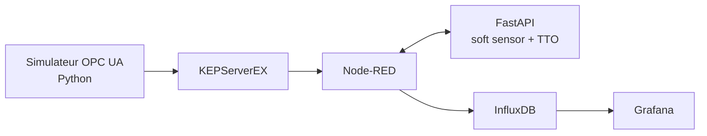
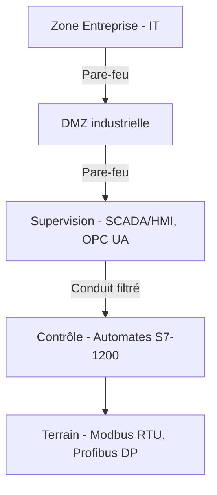

# Abderrahmane Chabaoui

**Élève ingénieur · Électromécanique & Digitalisation Industrielle · ENSAM Meknès**

Cybersécurité industrielle (OT) · Supervision SCADA · Automatisme · IIoT

> **Disponibilité** : je recherche un **stage de fin d'études (PFE) de 6 mois à partir de février 2027** en cybersécurité industrielle, SCADA ou automatisme.

---

## Profil

Élève ingénieur en Électromécanique et Digitalisation Industrielle, je travaille à l'interface entre le procédé industriel et les systèmes numériques. Mon expérience porte sur la collecte et la valorisation des données industrielles (OPC UA, MQTT, séries temporelles), la supervision (WinCC, FactoryTalk View SE) et la conception d'architectures OT sécurisées selon les principes de l'IEC 62443.

**Objectif** : contribuer à rendre les installations industrielles plus performantes, plus fiables et plus sûres.

---

## Domaines d'expertise

| Domaine | Compétences clés |
|---|---|
| **Cybersécurité OT** | Défense en profondeur, segmentation en zones et conduits, DMZ industrielle, cartographie des risques, sécurisation OPC UA et Modbus, notions IEC 62443 |
| **Automatisme & supervision** | Siemens S7-1200, TIA Portal, WinCC, FactoryTalk View SE, KEPServerEX, régulation PID |
| **IIoT & Industrie 4.0** | Node-RED, MQTT, InfluxDB, Grafana, jumeaux numériques, AAS, RAMI 4.0 |
| **Données & programmation** | Python (Pandas, OpenCV, FastAPI), C/C++, SQL, régression linéaire, Docker, ROS 2, Linux |

---

## Expérience professionnelle

### OCP Jorf Lasfar · Stagiaire IIoT et digitalisation industrielle
*Juillet 2026 – Septembre 2026 · Projet de fin d'année*

**Contexte** : station terminale du pipeline de pulpe de phosphate Khouribga – Jorf Lasfar (187 km).

**Réalisations** · *code disponible sur demande*
- **Capteur virtuel de densité** (régression linéaire multiple, validation Leave-One-Out) qui estime la densité de la pulpe à partir du courant de l'agitateur, du niveau et de la température.
- **Prédiction du temps avant débordement (TTO)** par régression sur fenêtre glissante, avec trois niveaux de risque.
- Modèles déployés dans un **microservice FastAPI**, découplé de l'orchestration Node-RED.
- **Chaîne IIoT conteneurisée** (Docker Compose) : OPC UA, Node-RED, InfluxDB, Grafana. Validée sur un bac pilote avec un simulateur OPC UA en Python.
- Étude de l'architecture de supervision **Rockwell FactoryTalk View SE** (HMI Server, FactoryTalk Linx, Historian).

**Technologies** : Python · OPC UA · KEPServerEX · Node-RED · FastAPI · Docker · InfluxDB · Grafana · FactoryTalk View SE

### Sofimed Maroc · Stagiaire instrumentation
*Juillet 2025 – Septembre 2025 · Stage d'initiation*

- Analyse et étude du fonctionnement du calculateur **Multiload II+**, utilisé sur les skids de chargement et de déchargement de GPL.

---

## Projets sélectionnés

| Dépôt | Description |
|---|---|
| **slurry-tank-digital-twin** *(privé, sur demande)* | Capteur virtuel de densité et prédiction de débordement : OPC UA, FastAPI, Node-RED, InfluxDB, Grafana, Docker |
| [**pv-digital-twin-opcua**](https://github.com/abderrahmanechabaoui/pv-digital-twin-opcua) | Jumeau numérique photovoltaïque : Simulink temps réel, KEPServerEX, Node-RED, analyse RAMI 4.0 |

### Architecture de cybersécurité d'un système industriel
*2026 – 2027 · Matériel et logiciel*

| Étape | Travail réalisé |
|---|---|
| Inventaire | Recensement des équipements (automates, SCADA/HMI) et des flux de communication |
| Analyse de risques | Cartographie des risques OT |
| Segmentation | Découpage du réseau en zones et conduits, filtrage des échanges |
| Défense en profondeur | Contrôle des accès, durcissement des postes |
| Protocoles | Sécurisation d'OPC UA (authentification, chiffrement) et de Modbus |

### Autres projets

| Projet | Période | Description | Technologies |
|---|---|---|---|
| **Supervision industrielle & passerelle IoT** | 2025 – 2026 | Programmation d'un automate S7-1200, écrans WinCC (conduite, états, alarmes), passerelle Node-RED vers le stockage et les tableaux de bord | TIA Portal, WinCC, Node-RED |
| **BMS pour batterie Li-ion** | 2026 – 2027 | Mesure des tensions, du courant et des températures, équilibrage des cellules, protections surcharge et décharge profonde, surveillance thermique | Électronique de puissance |
| **[Jumeau numérique photovoltaïque](https://github.com/abderrahmanechabaoui/pv-digital-twin-opcua)** | 2025 – 2026 | Modèle Simulink temps réel relié en OPC UA (KEPServerEX) à une IHM Node-RED en boucle fermée, et analyse RAMI 4.0 du système | MATLAB/Simulink, OPC UA, Node-RED |
| **Refroidissement d'un module batterie VE** | 2025 – 2026 | Modélisation de l'échauffement des cellules Li-ion et simulation du refroidissement du pack | Simulation thermique |

---

## Compétences techniques

| Catégorie | Outils et technologies |
|---|---|
| Automates & SCADA |      |
| Protocoles industriels |     |
| IIoT & données |     |
| Programmation |         |
| Embarqué |     |
| Simulation & CAO |     |
| Énergie | BMS · gestion thermique des batteries · photovoltaïque · électronique de puissance · schémas électriques |

---

## Formation

| Période | Établissement | Diplôme |
|---|---|---|
| 2024 – présent | École Nationale Supérieure d'Arts et Métiers (ENSAM), Meknès | Cycle ingénieur · Génie Électromécanique et Digitalisation Industrielle |
| 2022 – 2024 | ENSAM Meknès | Années préparatoires intégrées |
| 2022 | Lycée En-nasr, Casablanca | Baccalauréat Sciences Physiques |

---

## Certifications

| Certification | Organisme |
|---|---|
| Introduction to Cybersecurity | Cisco Networking Academy |
| Networking Basics | Cisco Networking Academy |
| KICKOFF Predictive Badge (gestion de projet) | PMI |

## Langues

**Arabe** : langue maternelle · **Français** : C1 (certifié TCF) · **Anglais** : courant

## Engagement associatif

- **Chef Média**, Club Robotique Arts et Métiers (CRIAM), 2025 – 2026
- Membre actif : Club Robotique, Events, Caravane Al Hayat, 2022 – 2026

---

**Contact** · [abderrahmanechabaoui@gmail.com](mailto:abderrahmanechabaoui@gmail.com) · [LinkedIn](https://www.linkedin.com/in/abderrahmane-chabaoui) · [Portfolio](https://abderrahmanechabaoui.github.io)

